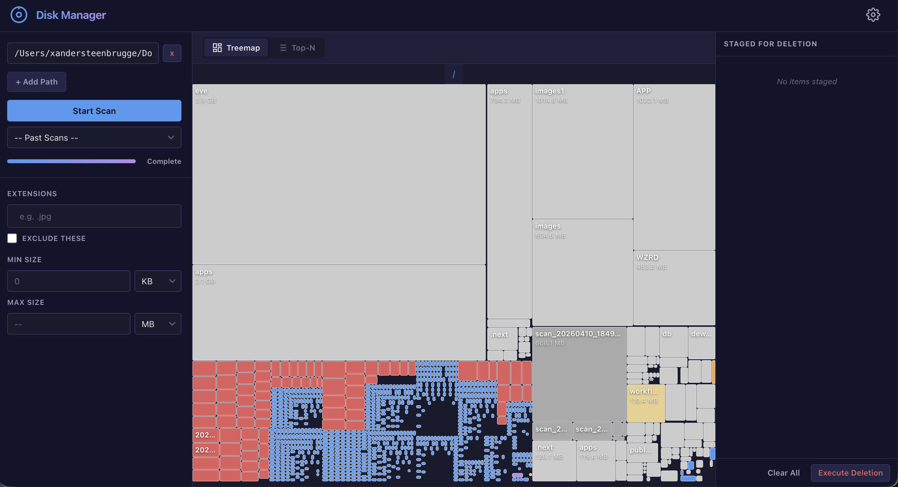

# Disk Manager

**Local-first disk space analyzer with an interactive web UI.**

Scan your filesystem, visualize where space is going with a zoomable D3.js treemap, and reclaim disk space with a safe, staged deletion workflow — all from your browser at `localhost:8000`.

- **Fast BFS scanning** with adaptive depth, symlink safety, and real-time SSE progress
- **Zoomable treemap** color-coded by file category (images, video, code, documents, etc.)
- **Filterable top-N lists** — sort by size, date, or extension; paginate through results
- **Staged deletion** — review what you're about to delete, then trash (with Finder "Put Back") or permanently remove
- **Per-session SQLite databases** — each scan is isolated, trivially deletable, and portable
- **Zero build step** — vanilla JS + D3.js frontend served as static files by FastAPI
- **File previews** — thumbnails for images, video frames (ffmpeg), and PDF pages (PyMuPDF)

> Built for macOS (Apple Silicon). Linux supported on a best-effort basis.



## Quick start

```bash
make install   # creates .venv, installs deps
make run       # starts on http://localhost:8000
make test      # runs pytest
PORT=9000 make run  # custom port
```

Requires Python 3.11+. Optional: `ffmpeg` for video thumbnails (`brew install ffmpeg`).

## Architecture overview

```
Browser (localhost:8000)
  |  fetch / EventSource (SSE)
  v
FastAPI (backend/main.py)
  |
  +-- scanner.py      BFS walk -> SQLite batches -> SSE progress
  +-- db.py           Per-session SQLite DB (WAL mode)
  +-- query_engine.py Parameterized SQL filter builder
  +-- staging_manager.py  SQLite-backed staging queue
  +-- deletion_engine.py  send2trash / permanent delete
  +-- preview_engine.py   Thumbnails (Pillow/ffmpeg/PyMuPDF)
  +-- config_manager.py   config.json read/write
  |
  v
scans/*.db   (one SQLite file per scan session)
```

Frontend is vanilla JS + D3.js (no build step). FastAPI serves it as static files from `frontend/`.

## Project structure

```
disk_manager/
  Makefile              # install, run, test, clean
  requirements.txt      # Python deps
  config.json           # auto-created on first run
  scans/                # per-session SQLite DBs
  backend/
    main.py             # FastAPI app, all routes, lifespan, CSRF middleware
    scanner.py          # BFS walker, adaptive depth, cancellation
    db.py               # SQLite schema, batch insert, tree queries, rollup
    query_engine.py     # Filter/sort/pagination SQL builder
    staging_manager.py  # SQLite-backed staging queue
    deletion_engine.py  # send2trash + permanent delete
    preview_engine.py   # Thumbnail gen (image/video/PDF) + cache
    config_manager.py   # config.json with defaults + validation
  frontend/
    index.html          # Single-page app shell
    styles.css          # Dark-mode CSS (grid layout, responsive)
    app.js              # AppState, api() helper, boot()
    scan-panel.js       # Path input, scan trigger, SSE progress, session picker
    filter-bar.js       # Extension/size/date filters, view toggle
    main-view.js        # Switches between treemap and top-N views
    treemap.js          # D3.js zoomable treemap with category colors
    topn-list.js        # Sortable table with virtual scroll
    preview-panel.js    # Slide-in thumbnail + metadata panel
    staging-panel.js    # Staged items list + deletion confirmation modal
    config-panel.js     # Settings modal (top-N, depth, skip dirs)
  tests/
    test_db.py          # 9 tests
    test_scanner.py     # 8 tests
    test_query_engine.py    # 9 tests
    test_config_manager.py  # 5 tests
    test_staging_manager.py # 6 tests
    test_deletion_engine.py # 7 tests
```

## Backend modules

### db.py — SQLite data layer

Each scan session gets its own `.db` file in `scans/`. Three tables:

- **`scan_meta`** — one row per scan: scan_id, status, roots, timestamps, totals.
- **`nodes`** — one row per filesystem entry: path (UNIQUE), name, extension, size, mtime/atime/ctime/birthtime, is_dir, depth, parent_path. No `scan_id` column (the DB file itself scopes the session).
- **`staged_items`** — crash-safe staging queue: path (PK), name, size, is_dir, extension.

Key indexes: extension (partial, files only), size DESC, mtime, atime, parent_path, composite (is_dir + size), composite (extension + mtime).

PRAGMAs: WAL journal, NORMAL sync, 512MB mmap, 64MB page cache.

Key functions:
- `init_db(path)` — create/open DB, apply schema
- `batch_insert(conn, records)` — `executemany` + `BEGIN IMMEDIATE`
- `compute_directory_sizes(conn)` — O(n) Python-side rollup (not SQL): fetches all nodes, accumulates file sizes into parent dirs in a dict, propagates deepest-first, then batch-updates
- `get_tree_data(conn, root, depth)` — recursive CTE bounded by depth, returns nested dict for D3
- `update_parent_sizes(conn, deleted_paths)` — recalculates affected parents after deletion

### scanner.py — Filesystem scanner

Iterative BFS using `os.scandir()` in a `ThreadPoolExecutor`. Key design:

- **FileRecord** dataclass with `__slots__` (~200 bytes per record)
- **Adaptive depth**: counts directory children *before* iterating, then uniformly reduces max_depth for all children if count > threshold
- **Skip dirs**: `node_modules`, `.git`, etc. are yielded as leaf nodes (with stat size) but not traversed
- **Symlink safety**: tracks visited real paths; symlinks to dirs recorded as files
- **Batching**: records grouped into batches of 500, inserted atomically
- **Cancellation**: `threading.Event` checked after each BFS iteration and each batch flush
- **Async bridge**: blocking producer thread puts `(batch, ProgressEvent)` tuples onto an `asyncio.Queue`; async generator consumes and yields SSE events

### query_engine.py — Filter & pagination

`FilterParams` (Pydantic model) -> parameterized SQL via `build_filter_query()`. Supports:
- Extension IN/NOT IN, size range, mtime/atime range, is_dir, name substring (LIKE)
- Sort via hardcoded `SORT_MAP` (never user-interpolated — prevents SQL injection)
- Pagination: LIMIT/OFFSET

### staging_manager.py — Staging queue

`StagingManager(conn)` — backed by `staged_items` table in the scan DB. In-memory dict for fast access, SQLite for crash-safe persistence. Methods: `add_items`, `remove_items`, `clear`, `get_state` (computes aggregates: total_size, count_by_extension, dir/file counts).

### deletion_engine.py — Deletion executor

`execute_deletion(paths, permanent)` -> `DeletionResult`. Path deduplication (skips children whose parent is also staged). Directories sorted deepest-first. Per-item error handling — never silently falls back from Trash to permanent delete. Returns deleted/failed/bytes_freed without touching the DB (caller handles DB cleanup).

### preview_engine.py — Thumbnails

Dispatches by extension category: Pillow for images, ffmpeg subprocess for video (frame at 5s), PyMuPDF for PDFs, SVG fallback for others. Cached as WebP at `~/.cache/disk_manager/{scan_id}/{md5(path)}.webp`. Spotlight exclusion via `.metadata_never_index`.

### config_manager.py — Configuration

`config.json` with defaults. Validates positive-int fields, clamps invalid values. Partial updates via `update(dict)`. Default skip dirs: `node_modules`, `.git`, `__pycache__`, `.venv`, `venv`, `target`, `.stack-work`.

## API endpoints

All prefixed with `/api/v1`. Mutation endpoints (POST/PATCH/DELETE) are protected by Origin-header CSRF check.

### Scans
| Method | Path | Description |
|--------|------|-------------|
| POST | `/scans` | Create scan session (returns scan_id) |
| GET | `/scans/{id}/stream` | SSE stream of ProgressEvent during scan |
| POST | `/scans/{id}/cancel` | Cancel a running scan |
| GET | `/scans` | List all scan sessions |
| GET | `/scans/{id}` | Get scan metadata |
| DELETE | `/scans/{id}` | Delete scan DB + thumbnail cache |

### Data queries
| Method | Path | Description |
|--------|------|-------------|
| GET | `/scans/{id}/tree?root=...&depth=3` | D3-compatible hierarchy JSON |
| GET | `/scans/{id}/top?n=25&mode=files&sort=size` | Top-N by size or mtime |
| GET | `/scans/{id}/files?extensions=...&min_size=...&sort=...&page=...` | Filtered paginated file list |

### Staging & deletion
| Method | Path | Description |
|--------|------|-------------|
| GET | `/scans/{id}/staging` | Current staging state |
| POST | `/scans/{id}/staging/add` | Add paths to staging |
| POST | `/scans/{id}/staging/remove` | Remove paths from staging |
| DELETE | `/scans/{id}/staging` | Clear all staged items |
| POST | `/scans/{id}/staging/execute` | Execute deletion (Trash or permanent) |

### Preview
| Method | Path | Description |
|--------|------|-------------|
| GET | `/scans/{id}/preview/thumbnail?path=...` | WebP thumbnail (cached) |
| GET | `/scans/{id}/preview/meta?path=...` | Full node metadata |
| POST | `/scans/{id}/preview/open` | Reveal in Finder (`open -R`) |

### Config
| Method | Path | Description |
|--------|------|-------------|
| GET | `/config` | Current config |
| PATCH | `/config` | Partial update |

## Frontend architecture

Single-page vanilla JS app. No build step. Modules communicate via custom DOM events:

- `scan-ready` — scan completed or past session selected (carries scan_id + roots)
- `filters-changed` — any filter input changed (debounced 300ms)
- `show-preview` — file clicked (carries path + metadata)
- `staging-changed` — items added/removed from staging
- `open-config` — open settings modal

`AppState` (in `app.js`) is the single source of truth: currentScanId, filters, viewMode, topN, stagedItems, etc.

D3.js treemap: cells colored by file category (image=blue, video=red, audio=orange, document=green, code=purple, archive=gold). Click directory to zoom (lazy-loads subtree at depth=3). Right-click to stage for deletion.

## Key design decisions

1. **Per-session DB files** — each scan is an isolated SQLite file. No `scan_id` column on `nodes` (the file itself scopes the session). Enables trivial cleanup (delete the file) and future cross-session comparison via `ATTACH DATABASE`.

2. **O(n) directory size rollup** — post-scan, sizes are accumulated in a Python dict (one pass over all nodes), then propagated deepest-first, then batch-updated. Replaces the O(depth * num_dirs) correlated SQL subquery approach.

3. **SSE over WebSocket** — scanning is unidirectional push. SSE reconnects automatically, works over HTTP/1.1, no library needed on the frontend.

4. **Staging backed by SQLite** — `staged_items` table provides crash-safe persistence instead of a separate JSON file.

5. **Trash-first deletion** — `send2trash` provides Finder "Put Back" support. Never silently falls back to permanent delete. Per-item error handling with explicit failure reporting.

6. **Scan cancellation** — `threading.Event` checked in the BFS loop and after each batch. `POST /cancel` sets the event.

## Testing

```bash
make test   # or: .venv/bin/python -m pytest tests/ -v
```

44 tests covering all backend modules. Tests use `tmp_path` fixtures — no real files are ever deleted. Key test areas:
- DB schema creation, batch insert, tree queries, directory size rollup
- BFS walker: depth limits, symlink handling, skip dirs, extensions, cancellation
- Query builder: filters, pagination, sort, name search
- Staging: add/remove/clear, SQLite persistence across manager instances
- Deletion: path deduplication, permanent delete, error handling
- Config: defaults, merge, validation, partial update

## macOS-specific notes

- **Full Disk Access**: scanning Desktop/Documents/Downloads on Ventura+ requires TCC permission. `PermissionError` paths are logged and skipped.
- **APFS file clones**: sizes shown are logical (what you recover on delete). Physical block sharing makes actual freed space unpredictable.
- **birthtime**: `os.stat().st_birthtime` is macOS-only (NULL on Linux). `ctime` on macOS is metadata change time, not creation time.
- **Spotlight exclusion**: thumbnail cache at `~/.cache/disk_manager/` has `.metadata_never_index`.
- **Video thumbnails**: ffmpeg required (`brew install ffmpeg`). Falls back to SVG icon if unavailable.
